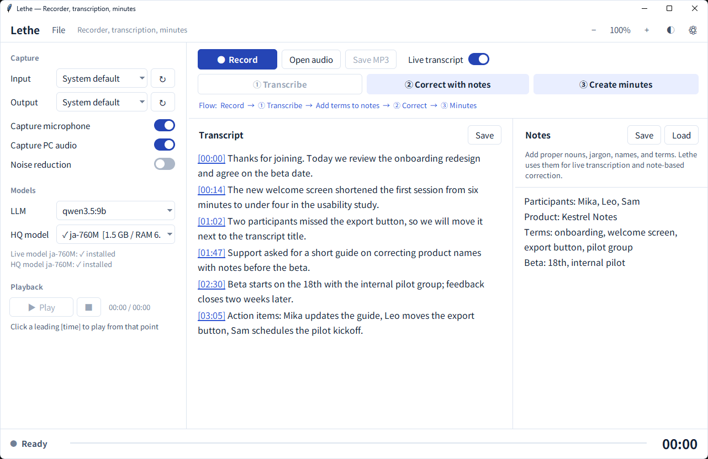

# Lethe

[](
https://github.com/Hitoshi-Nakanishi/lethe-app/actions/workflows/tests.yml)


[](LICENSE)

**Turn meeting audio into transcripts and minutes on your own computer.**

Lethe records audio, transcribes it with Whisper, uses your notes to correct names and terms, and creates Markdown minutes with
Ollama. Once models are downloaded, processing runs locally: audio, transcripts and notes stay on your machine.

Japanese documentation: [README.ja.md](README.ja.md)

<picture>
  <source media="(prefers-color-scheme: dark)" srcset="docs/assets/lethe-en-dark.png">
  
</picture>

The transcript and your notes sit side by side. Recording and processing controls stay above them; click a timestamp to listen
back to that moment.

## From audio to minutes

1. **Record or open audio.** Capture a microphone and, on Windows, PC output. Save the audio now or return to it later.
2. **Transcribe and review.** Get timestamped text, listen back and edit. Live transcription is available as a preview.
3. **Correct with notes.** Add names and specialist terms so Ollama can fix misrecognitions using your spellings.
4. **Create minutes.** Review and save the generated Markdown. Keep audio, transcript and notes together in a session, or export
   them as a dataset.

Recording and transcription work without Ollama. Correction and minutes need a local Ollama service and an installed LLM.

## Quick start

Install [Task](https://taskfile.dev/) and Python 3.14.4 with Tk support. From the checkout:

```sh
task setup
task download-whisper-models
task run
```

Setup prepares the Python environment using uv; the download command fetches the configured speech models. The default is
Japanese-only. See [model setup](docs/setup.md#models) to choose another language or model.

For correction and minutes, install and start Ollama, then run:

```sh
task download-llm-models
```

Choose your audio devices in the sidebar and start recording. If setup needs attention, see the
[setup guide](docs/setup.md#troubleshooting).

## Documentation

- [Setup](docs/setup.md): models, configuration, macOS audio/Tk requirements and Docker.
- [Usage](docs/usage.md): recording, review, sessions, export, themes and shortcuts.
- [Contributing](CONTRIBUTING.md): development and checks.
- [Architecture](docs/architecture.md): source layout and processing flow.

[MIT License](LICENSE).
